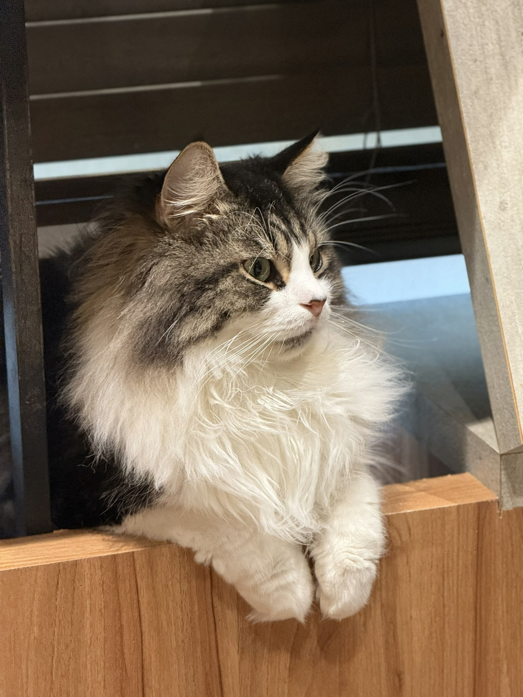
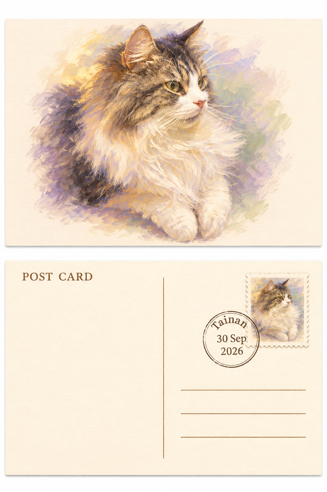
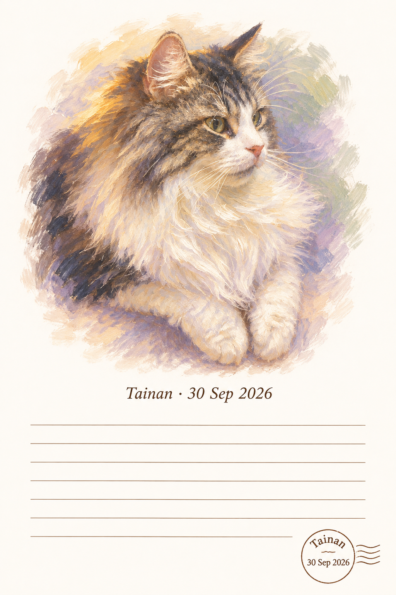
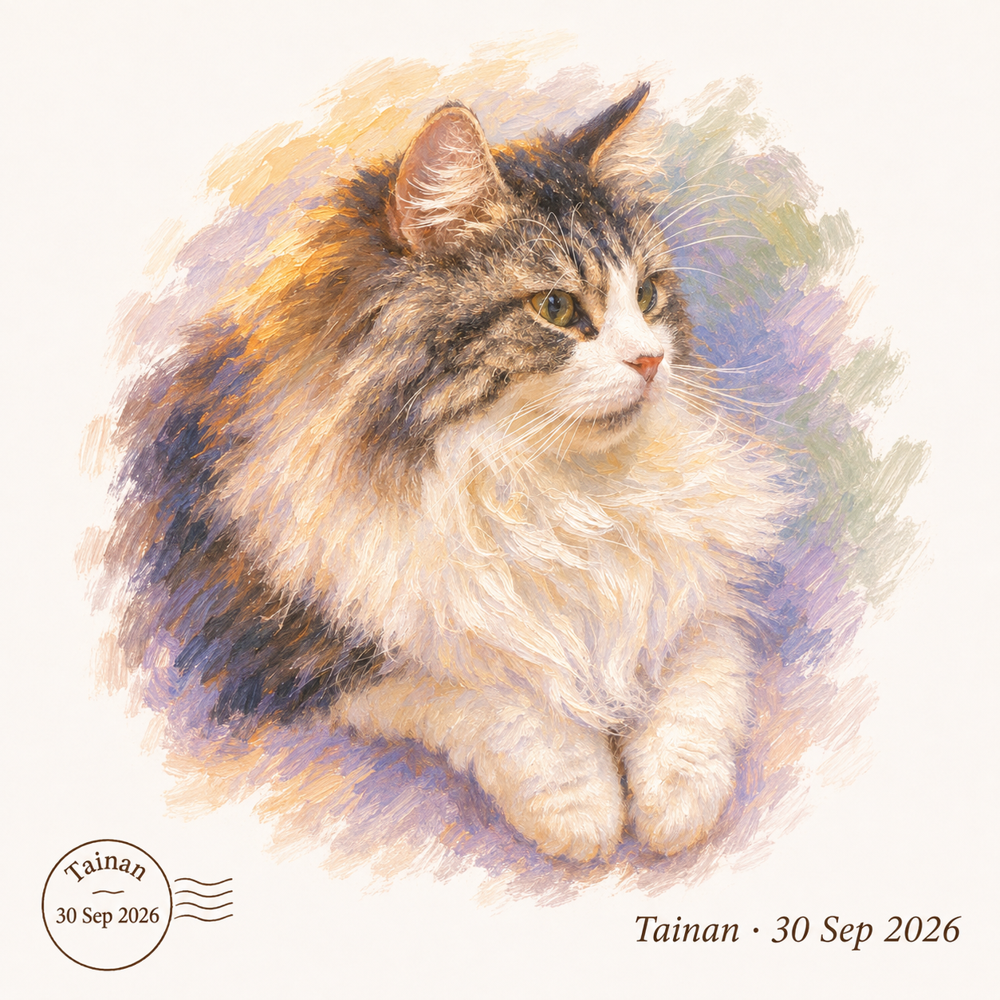
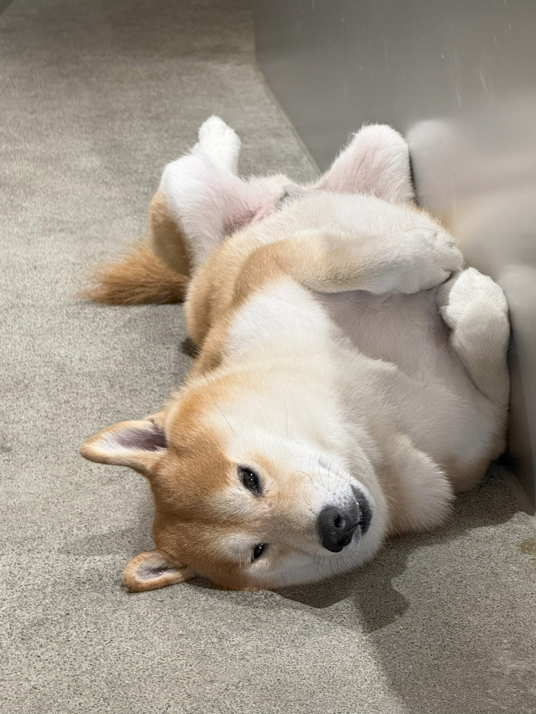
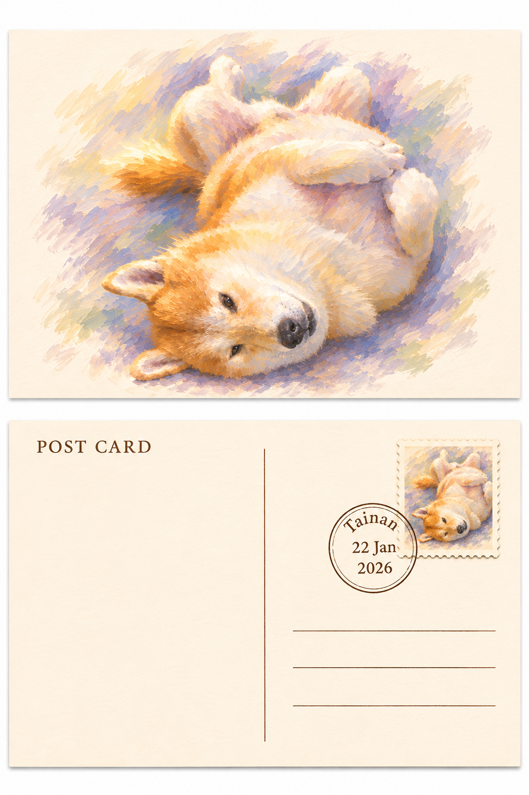
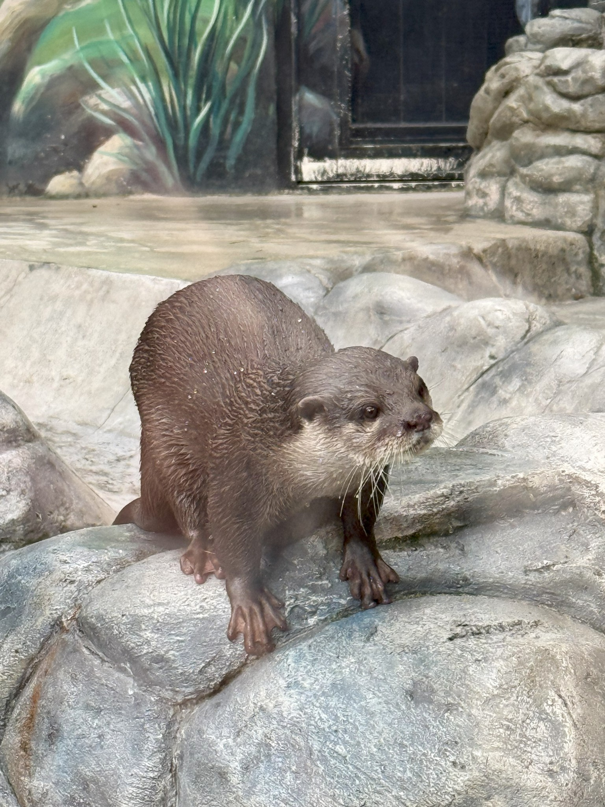
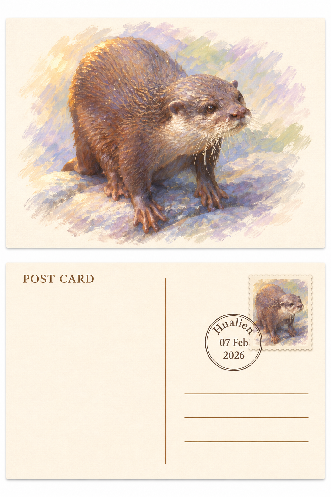

# 午後光工作室：動物油畫明信片 Agent

上傳一張自己拍的動物照片，附上拍攝地點與日期，就能得到一張**印象派（莫內風）油畫明信片**。
做完明信片後，Agent 會再詢問要不要用同一張照片做成**手帳內頁**或 **IG 貼文**。
不論上傳的是什麼動物，畫風、光線、版型都保持一致。

> 生成式 AI 課程 Week12 作業：統一風格圖像產生的 Agent

## 作品

<table>
  <tr>
    <th>原始照片</th>
    <th>明信片（預設）</th>
    <th>手帳內頁</th>
    <th>IG 貼文</th>
  </tr>
  <tr>
    <td><br>長毛貓｜Tainan · 30 Sep 2026</td>
    <td></td>
    <td></td>
    <td></td>
  </tr>
  <tr>
    <td><br>柴犬｜Tainan · 22 Jan 2026</td>
    <td></td>
    <td></td>
    <td></td>
  </tr>
  <tr>
    <td><br>水獺｜Hualien · 07 Feb 2026</td>
    <td></td>
    <td></td>
    <td></td>
  </tr>
</table>

## 使用工具

| 用途 | 工具 |
|---|---|
| 生成作品（Agent 本體） | **ChatGPT 專案**：專案指示＋圖片生成 |
| 討論風格、撰寫專案指示 | Claude |

## 風格設定（重點）

完整的專案指示在 [AGENTS.md](AGENTS.md)。

- **畫風**：法國印象派（莫內風）油畫。筆觸短而分開、看得出來，邊緣柔和，有油彩厚度。
- **動物**：品種、毛色、花紋、臉型、姿勢必須和照片一致，只改畫風。
- **光線**：一律畫成「午後暖陽」。光從左上方照入，亮面偏暖金色，陰影偏紫藍色。
- **暈開式畫法**：刪除照片原本的背景。油彩只畫在動物和周圍一圈，越往外越淡，四角保持奶油白紙色。
- **文字**：只用英文的地點和日期，字體是深棕色襯線體。
- **固定英文風格段落**：每次生成都要一字不改地放進提示詞，讓不同的人、不同的照片都得到相同風格。

## 三種版型

| 版型 | 尺寸 | 內容 |
|---|---|---|
| 明信片（預設） | 2:3 直式 | 上下排成正反兩面。正面是動物油畫。背面是經典明信片：左半空白留言區，右半是地址線，還有同一隻動物的油畫郵票和地點日期郵戳 |
| 手帳內頁 | 2:3 直式 | 上方是動物油畫，中間一行「地點 · 日期」，下方是書寫橫線和郵戳 |
| IG 貼文 | 1:1 方形 | 動物置中，角落放「地點 · 日期」和郵戳 |

## 使用方式

1. 在 ChatGPT 建立專案，把 [AGENTS.md](AGENTS.md) 中「專案指示」那一段貼進 **Instructions**。
2. 在專案裡開一個新對話，上傳一張動物照片，附上地點和日期，例如：
   ```
   地點：台南，日期：2026/09/30
   ```
3. Agent 的處理流程：
   1. 列出動物的特徵
   2. 把地點和日期換算成英文
   3. 生成明信片
   4. 自我檢查
   5. 詢問要不要再做手帳內頁或 IG 貼文
4. 建議一張照片開一個對話，避免互相影響。

## 製作流程

1. **討論與設定**：和 Claude 用問答的方式決定風格：工具、油畫流派、色調、背景、版型、文字。接著寫成 `AGENTS.md`。
2. **建立 Agent**：把專案指示貼進 ChatGPT 專案。
3. **生成與檢查**：上傳照片生成作品，逐張對照設定，檢查有沒有跑掉。
4. **調整設定**：看了成品後回頭修改指示，從 v1 修到 v3，再重新生成。每一版改了什麼，記錄在 AGENTS.md 最後的「版本紀錄」。

## 資料夾結構

```
├── README.md
├── AGENTS.md      ← 專案指示（風格設定）＋版本紀錄
├── photos/        ← 原始照片
└── outputs/       ← 生成作品
```

照片都已經轉成 JPG，並移除 EXIF 位置資訊。
